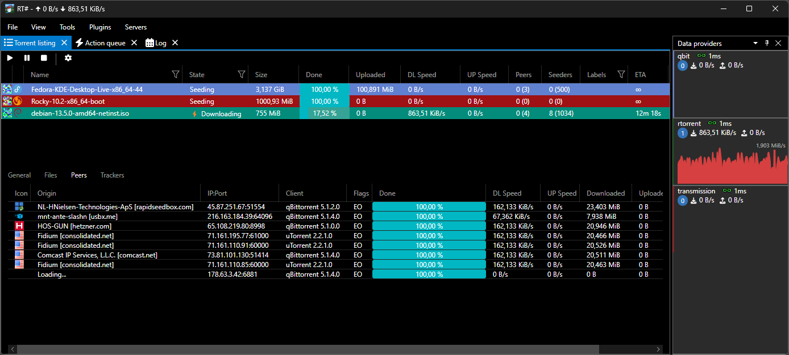

## RTSharp

RTSharp is a cross-platform bittorrent daemon GUI written in C# using AvaloniaUI framework. RTSharp supports multiple types of daemons with some additional features when it is not supported by the daemon itself.

### Requirements

Client application requirements are the same as for [AvaloniaUI](https://docs.avaloniaui.net/docs/faq#what-platforms-are-supported), however mobile, embedded systems and wasm are not supported.
Daemon must be run in a linux environment.

### Security

> [!CAUTION]
> Granting access to `RTSharp.Daemon` is equivalent to granting shell access. Daemon implements a runtime scripting interface that can be used to perform any action. Add clients to `AllowedClients` with caution.

### Getting started

See [setting up data providers](docs/setup-dataproviders.md)

### Features

 - Multiple servers/torrent daemons in the same GUI
 - RTSharp.Daemon
   - Remote folder selection
   - Torrent data copy to other servers
   - Mediainfo
   - Runtime scripting
   - Prometheus tracker metrics endpoint
 - Standalone built-in torrent creation
 - Peer AS listing
 - Custom names for trackers
 - Virtualized main torrent list with filtering & search
 - Plugins for custom torrent daemon support & extensibility

### Supported daemons

||rtorrent|qbittorrent|transmission|
|-|-|-|-|
|Torrent Listing|🟡Delta changes|🟢Delta changes|🟢Delta changes|
|File listing|🟢Supported|🟢Supported|🟢Supported|
|Peer listing|🟢Supported|🟢Supported|🟡No downloaded/uploaded column|
|Tracker listing|🟢Supported|🟡Only URI, seeders, peers|🟢Supported|
|Start torrent|🟢Supported|🟢Supported|🟢Supported|
|Pause torrent|🟢Supported|🟢Supported|🔴Unsupported by daemon|
|Stop torrent|🟢Supported|🔴Unsupported by daemon|🟢Supported|
|Force recheck (rehash)|🟢Supported|🟢Supported|🟢Supported|
|Reannounce to all trackers|🟢Supported|🟢Supported|🟢Supported|
|Add torrent|🟢Supported|🟢Supported|🟢Supported|
|Add torrent paused|🟢Supported|🟢Supported|🟢Supported|
|Move download directory|🟢With data move & checks|🟢Supported|🟢Supported|
|Remove torrent|🟢Supported|🟢Supported|🟢Supported|
|Remove torrent & data|🟢Supported|🟢Supported|🟢Supported|
|Add label|🟢Supported|🟢Supported|🟢Supported|
|Set labels|🟢Supported|🟢Supported|🟢Supported|
|Add peer|🟢Supported|🟢Supported|🔴Unsupported by daemon|
|Ban peer|🟢Supported|🟢Supported|🔴Unsupported by daemon|
|Get .torrent|🟢Supported|🟢Supported|🟡With daemon access to config dir|
|Prefill default save path|🟢Supported|🟢Supported|🟢Supported|
|Pieces progress bar|🟢Supported|🟢Supported|🟢Supported|
|Partial downloads|🟢Supported|🟢Supported|🟢Supported|
|Add new tracker|🔴Unsupported by daemon|🟢Supported|🟢Supported|
|Remove tracker|🔴Unsupported by daemon|🟢Supported|🟢Supported|
|Replace tracker|🟡Hacky workaround*|🟢Supported|🟢Supported|
|Global download statistics|🟡Workaround*|🟢Supported|🟢Supported|
|Global upload statistics|🟡Workaround*|🟢Supported|🟢Supported|
|Global ratio statistics|🟡Workaround*|🟢Supported|🟢Supported|
|Sequential downloads|🔴Unsupported by daemon|🟢Supported|🟢Supported|
|Extended statistics|🔴Not implemented|🔴Not implemented|🔴Not implemented|
|File renaming|🔴Not implemented|🔴Not implemented|🔴Not implemented|
|Torrent renaming|🔴Not implemented|🔴Not implemented|🔴Not implemented|
|Remote daemon settings|🟢Supported|🟢Supported|🟢Supported|
|Daemon log inspection|🟡Supported*|🟢Supported|🟡Supported*|
|Fast recheck|🟢Supported|🟢Supported|🟢Supported|
|Magnet links|🟢Supported|🟢Supported|🟢Supported|

_* - not directly supported by torrent daemon_

### Other features

|Feature|Support|
|-|-|
|Edit torrent|🟢Supported|
|V2/Hybrid torrent creation|🟢Supported|
|File previews|🟡mpv only|
|File icons (as determined by OS)|🟡Not on macOS|

### Built-in plugins

#### AutoIntegrify

Searches for files in specified directories, (ref/hard)links files to torrent directory to recheck torrent to 100% integrity

#### ColoredRatio

Example plugin. Makes ratio column colored.

#### MassTrackerRewrite

Rewrites tracker in torrents to some other URI.

#### CrossSeed

Searches Torznab indexers for the same content on other trackers, verifies candidates against the files on disk, and adds them with fast resume.